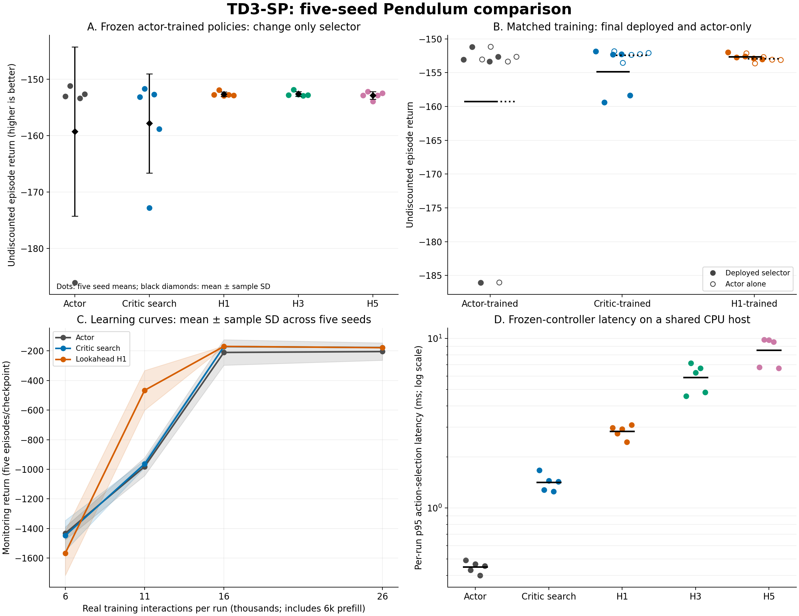
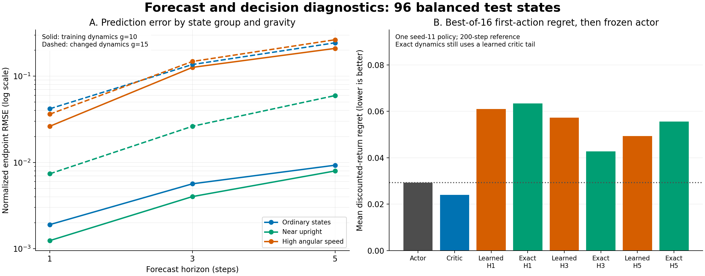

# Extensive TD3-SP lookahead results

Measured on **2026-11-25**. The [predeclared protocol](LOOKAHEAD_TEST_PROTOCOL.md),
[analysis JSON](results/lookahead_extensive/analysis.json), and [artifact index](results/lookahead_extensive/artifact_index.json)
record the settings, calculations, complete episode outcomes, and source hashes.

## Main result

All 15 planned training runs completed. Frozen H1 minus actor was **+6.606 [-11.804, +25.016]**
return points; H1 minus critic search was **+5.190 [-5.493, +15.874]**.
After matched training, the deployed H1-trained controller minus actor-trained
controller was **+6.611 [-12.044, +25.266]**, and minus critic-trained
controller was **+2.188 [-2.170, +6.546]**. Brackets are nominal
95% paired Student-t intervals on **five training-seed means**, with four degrees
of freedom. The four primary paired intervals include zero, so these five seeds do not establish an average H1 advantage over either comparison in either experiment.

These results are conditional on standard Pendulum, one fixed predictor, one
shared dataset, and the declared reset set. The earlier five-episode smoke check
used a 650-step policy; it is not pooled with these 20,000-step results.



## Design and interaction accounting

Seeds were 11, 22, 33, 44, 55. Each method received the same 6,000 real
archived transitions and 20,000 new interactions, with 1,000 random warm-up steps,
19,000 TD3 training calls, and 9,500 delayed actor updates. Every seed began with
identical actor/critic weights across methods. The 16-candidate, H1 configuration
was fixed before outcomes were examined; H3/H5 were secondary diagnostics.
All behavior modes used private selector random streams.

Twenty final reset seeds, 900000–900019, were held fixed across methods. Monitoring
used five different seeds at 0/5k/10k/20k new interactions. The final checkpoint
was always step 20k; monitoring did not select a best checkpoint. Evaluation
data never entered replay or predictor fitting.

There were **300,000 new training interactions**, plus
**6,000 unique shared collection transitions**
(306,000 unique training collection interactions).
Counting reuse of the same prefill across 15 runs gives 390,000
transition exposures; it does not mean that many unique transitions were collected.
Evaluation excluded from training executed **240,000 interactions**:
60,000 monitoring and 180,000 final.
The repeated serialized actor/deployed/frozen entries are counted once.
Diagnostics below are a separate designed-state analysis.
The separate post-hoc early-checkpoint follow-up added 140,000
evaluation interactions, bringing benchmark plus follow-up evaluation to
380,000. It added no training data.

## Frozen policies: does adding a selector help?

Each row uses one actor-trained actor/critic checkpoint with every selector.
Entries are actual undiscounted 200-step returns averaged over 20 reset episodes.
Higher is better.

| Training seed | Actor | Critic search | H1 | H3 | H5 |
| --- | ---: | ---: | ---: | ---: | ---: |
| 11 | -153.050 | -153.142 | -152.731 | -152.795 | -152.880 |
| 22 | -151.175 | -151.683 | -151.932 | -151.840 | -152.192 |
| 33 | -186.037 | -172.798 | -152.924 | -152.694 | -153.940 |
| 44 | -153.360 | -152.729 | -152.782 | -152.898 | -152.843 |
| 55 | -152.655 | -158.847 | -152.878 | -152.791 | -152.461 |
| Mean ± sample SD | -159.255 ± 14.995 | -157.840 ± 8.815 | -152.649 ± 0.409 | -152.604 ± 0.433 | -152.863 ± 0.666 |

H1 exceeded actor return in 3/5 seeds and
critic search in 3/5. Pairing improves
comparability but does not make 100 evaluation episodes into 100 independently
trained policies. The t intervals assume reasonably well-behaved independent
seed differences; with five seeds they are sensitive to outliers. They are
unadjusted, and no multiple-comparison-adjusted superiority claim is made.

## Matched training: does the behavior policy improve learning?

These policies were independently trained from the matched initial weights and
interaction budgets. Each is evaluated with its deployed controller.

| Training seed | Actor-trained | Critic-trained | H1-trained |
| --- | ---: | ---: | ---: |
| 11 | -153.050 | -151.824 | -151.994 |
| 22 | -151.175 | -159.410 | -152.757 |
| 33 | -186.037 | -152.309 | -152.609 |
| 44 | -153.360 | -152.277 | -152.858 |
| 55 | -152.655 | -158.343 | -153.004 |
| Mean ± sample SD | -159.255 ± 14.995 | -154.833 ± 3.716 | -152.644 ± 0.391 |

H1-trained deployed return exceeded actor-trained return in
3/5 seeds and critic-trained
return in 2/5. The actor-only
evaluation below removes planning at deployment. Its endpoint can differ from
the combined controller even though both use the same trained actor weights.

| Training method | Final actor-only return, mean ± SD | Normalized sparse monitoring AUC, mean ± SD |
| --- | ---: | ---: |
| Actor | -159.255 ± 14.995 | -555.093 ± 27.112 |
| Critic search | -152.424 ± 0.664 | -530.787 ± 11.696 |
| Lookahead H1 | -152.937 ± 0.555 | -421.239 ± 28.759 |

The AUC integrates the four monitored returns with trapezoids from 6k to 26k real
training interactions, then divides by the 20k interval. It is a coarse average
monitoring return, not a densely measured learning curve or an integral over
the unobserved initial 0–6k interval. It is secondary to the fixed final endpoints.

## Secondary post-hoc check: the 5,000-step checkpoint

After observing the first two seeds' monitoring curves, we selected the saved
5k checkpoint for a follow-up on **new** reset seeds 910000–910019. This choice
was made after seeing results, so these findings are explicitly **secondary and
post-hoc**. Fresh reset seeds prevent reuse of the monitoring scenarios; they do
not turn this checkpoint choice into a preregistered primary endpoint. Training
and model settings were unchanged. The checkpoint had 11,000 real-transition
exposures including prefill.

| Seed | Actor-trained | Critic-trained deployed | H1-trained deployed | Critic-trained actor alone | H1-trained actor alone |
| --- | ---: | ---: | ---: | ---: | ---: |
| 11 | -982.208 | -935.908 | -393.901 | -862.178 | -771.793 |
| 22 | -894.565 | -883.979 | -459.648 | -883.699 | -904.651 |
| 33 | -1039.551 | -986.226 | -499.871 | -1007.868 | -961.469 |
| 44 | -1065.424 | -967.401 | -458.024 | -1054.011 | -874.400 |
| 55 | -1037.938 | -951.368 | -723.555 | -1024.877 | -1067.541 |
| Mean ± sample SD | -1003.937 ± 68.263 | -944.976 ± 38.885 | -507.000 ± 126.865 | -966.527 ± 87.345 | -915.971 ± 109.187 |

| Secondary early contrast | Mean paired difference [95% t interval] | Positive seeds |
| --- | ---: | ---: |
| H1-trained deployed minus actor-trained | +496.938 [+345.437, +648.439] | 5/5 |
| H1-trained deployed minus critic-trained | +437.977 [+282.625, +593.328] | 5/5 |
| H1-trained actor alone minus actor-trained | +87.966 [-49.670, +225.603] | 3/5 |
| Critic-trained actor alone minus actor-trained | +37.411 [-20.935, +95.756] | 5/5 |
| Frozen early policy: H1 minus actor | +382.435 [+165.672, +599.197] | 5/5 |
| Frozen early policy: H1 minus critic search | +353.665 [+131.740, +575.590] | 5/5 |
| Frozen early policy: critic search minus actor | +28.770 [-36.803, +94.342] | 4/5 |

These intervals are exploratory and do not account for selecting the 5k
checkpoint after observing monitoring outcomes.

The early frozen actor-trained controller means were
-1003.937 ± 68.263 for actor-only,
-975.168 ± 50.608 for critic search, and
-621.503 ± 183.275 for H1. This separates
an effect of planning at deployment from an effect learned through assisted
training. Any early advantage should be confirmed by a new experiment that
predeclares the early checkpoint. The primary 20k results remain the main endpoint.
All 35 additional evaluations preserved network/RNG invariants and recorded
0 fallbacks and 0 invalid candidates.

## Compute and numerical reliability

| Training method | Online training seconds, mean ± SD | Unique evaluation seconds per worker, mean ± SD |
| --- | ---: | ---: |
| Actor | 113.041 ± 3.451 | 49.761 ± 5.302 |
| Critic search | 121.854 ± 7.761 | 9.115 ± 1.904 |
| Lookahead H1 | 147.191 ± 11.118 | 16.306 ± 0.668 |

Training time includes interaction, selection, replay insertion, and TD3 updates.
It excludes earlier predictor fitting, shared data collection, checkpoint I/O,
and evaluation. Actor-trained workers perform more final selector comparisons,
so their evaluation workload is intentionally larger. Up to three CPU workers
ran concurrently with one PyTorch thread each. The summed online worker time was
1910.4s and summed unique evaluation time
375.9s; these overlapping worker wall times
are not elapsed campaign time or isolated CPU benchmarks.

| Frozen controller | Mean ± SD of five run-level p95 latencies (ms) | Largest observed latency (ms) | Mean intervention rate |
| --- | ---: | ---: | ---: |
| Actor | 0.449 ± 0.035 | 8.714 | 0.0% |
| Critic search | 1.416 ± 0.168 | 44.014 | 90.7% |
| H1 | 2.836 ± 0.245 | 94.698 | 93.6% |
| H3 | 5.899 ± 1.147 | 125.137 | 93.5% |
| H5 | 8.522 ± 1.653 | 137.034 | 86.0% |

These p95 statistics are summarized across runs, not a pooled p95 reconstructed
from percentile summaries. Shared-host scheduling and first-call overhead remain
in the measurements. There were **0 training and 0 evaluation fallbacks**,
and **0 training and 0 evaluation invalid candidates**.
All recorded invariants passed: fixed predictor, real-only replay, evaluation
excluded from learning, frozen weights/buffers, and unchanged global random streams.
Zero numerical failures does not establish physically valid predictions.

## Forecast and action-ranking diagnostics

The independent diagnostic set contains 32 ordinary, 32 near-upright, and 32
high-angular-speed states. These balanced strata are not an estimate of the
controller's operating distribution. Training scales normalize forecast error.
The predictor is unchanged, and no outcome here is used for fitting or tuning.



| Forecast horizon | Normalized RMSE, original gravity 10 | Normalized RMSE, changed gravity 15 |
| --- | ---: | ---: |
| 1 | 0.01522 | 0.03229 |
| 3 | 0.07312 | 0.11729 |
| 5 | 0.12137 | 0.21046 |

At H5 with original dynamics, normalized RMSE was
0.00929 for ordinary states,
0.00797 near upright, and
0.20986 at high speed. In the high-speed stratum,
50.0% of predicted endpoint velocities exceeded
the physical ±8 limit; the largest magnitude was 10.616.
62.5% violated at least one observation bound.
Finite-value checks do not detect these errors. Gravity 15 is a deliberately
changed plant, exposing dynamics mismatch rather than measuring routine accuracy.

The decision test uses only the final seed-11 actor-trained policy and the same
16 candidate first actions at each state. Reference values are discounted
200-step returns after that first action followed by the frozen actor. Regret
is relative to the best tested candidate, not a globally optimal action or the
full replanning controller. Its units differ from the undiscounted episodic
returns above.

| First-action selector | Mean regret to best tested candidate | Mean pairwise ranking agreement |
| --- | ---: | ---: |
| actor | 0.02925 | — |
| critic | 0.02403 | 0.618 |
| learned_h1 | 0.06093 | 0.592 |
| oracle_h1 | 0.06342 | 0.714 |
| learned_h3 | 0.05721 | 0.560 |
| oracle_h3 | 0.04270 | 0.689 |
| learned_h5 | 0.04928 | 0.618 |
| oracle_h5 | 0.05557 | 0.669 |

Learned H1 regret was 0.06093; exact-dynamics H1 regret
was 0.06342. Exact lookahead still uses a learned critic
at its tail. The actor already has little local improvement headroom in this
diagnostic, and replacing learned dynamics with exact dynamics alone does not
make the H1 score select better actions here. This supports investigating critic
tail accuracy and scoring, alongside model error, before increasing model size
or planning horizon.

Exact dynamics matched installed Gymnasium observations within
2.38e-07 and rewards within
3.55e-15 over 256 one-step cases.
Twelve independently stepped 200-step reference traces matched the vectorized
return calculation within 9.49e-07.
Complete states, candidate scores, reference returns, and group metrics are
preserved in the raw diagnostic records.

## Software findings and next steps

**125 tests passed** in the expanded suite. Stress tests found two API
defects: float64 action bounds could alias mutable caller arrays, and complex
critic/reward outputs could discard imaginary NaNs during casting. Bounds are
now copied and complex scores rejected. Both fixes preceded the full benchmark;
normal finite float32 scoring is unchanged. The suite also verifies independent
return calculations, mixed terminal times, late numerical faults, fallback
recovery, immutable inputs, optimizer/RNG/mode restoration after exceptions,
atomic checkpoint loading, and exact-dynamics diagnostic calculations.

Keep the H1 feature experimental and compare against both existing controllers
for each new task. Prioritize valid-state prediction at speed limits and under
dynamics changes, then inspect candidate ordering and critic-tail error. Further
tests should use independently fitted predictors, more policy seeds, and a task
with meaningful planning headroom. AUV conclusions require representative
vehicle dynamics, reward/termination rules, disturbance scenarios, and direct
navigation outcomes. GPU hardware was not tested.

## Reproduction and artifacts

Base revision was `ad6045f`. The manifest's individual
source SHA256 values identify the actual tested working tree, including the two
defensive fixes and benchmark runner; the unmodified base revision alone is not
the tested code. Original and archived JSON hashes are retained in the artifact
index. Raw result JSON is minified without dropping any episode or candidate data;
the manifest is copied byte-for-byte. Large checkpoints are not committed.

```bash
python -m pip install -r requirements-experiments.txt
python experiments/lookahead_benchmark.py run --output runs/lookahead-extensive --data runs/pendulum-data.npz --predictor runs/pendulum-improved/model.pt --steps 20000 --warmup 1000 --seeds 11 22 33 44 55 --batch_size 64 --episodes 20 --monitor_episodes 5 --workers 3
python experiments/lookahead_diagnostics.py --phase all --prediction_checkpoint runs/pendulum-improved/model.pt --policy_checkpoint runs/lookahead-extensive/seed_11/actor/checkpoint_20000 --output runs/lookahead-extensive-diagnostics/final --threads 1
python experiments/lookahead_early_checkpoint.py --benchmark_dir runs/lookahead-extensive --output runs/lookahead-extensive-early --checkpoint 5000 --reset_seed 910000 --episodes 20
python experiments/summarize_lookahead.py --input runs/lookahead-extensive --diagnostics runs/lookahead-extensive-diagnostics/final --early runs/lookahead-extensive-early --output docs/results/lookahead_extensive --report docs/LOOKAHEAD_EXTENSIVE_RESULTS.md --test-count 125 --measurement-date 2026-11-25
```

Use fresh output paths when reproducing; scripts preserve existing results.
The shared dataset/predictor workflow is documented in
[the prediction results](STATE_PREDICTION_RESULTS.md). Rebuilding figures from
committed records requires no retraining: use `--input docs/results/lookahead_extensive`
and `--diagnostics docs/results/lookahead_extensive/raw` plus
`--early docs/results/lookahead_extensive` with new output/report paths.
